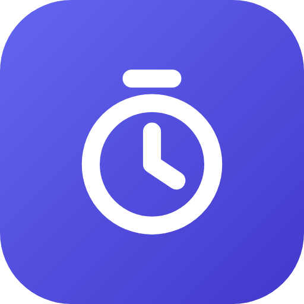

<p align="center">
  
</p>
<h1 align="center">FocusFloat</h1>
<p align="center"><b>Stay on the page.</b></p>

<p align="center">
  
</p>

<p align="center">
  <a href="https://3moor111.github.io/FocusFloat/"><b>Website</b></a> ·
  <a href="https://github.com/3moor111/FocusFloat/releases/latest/download/FocusFloat.apk"><b>Download the APK</b></a> ·
  <a href="https://3moor111.github.io/FocusFloat/tools.html">Every tool</a> ·
  <a href="https://3moor111.github.io/FocusFloat/install.html">Install</a> ·
  <a href="https://3moor111.github.io/FocusFloat/film.html">The film</a>
</p>

**FocusFloat** is a free focus app for students on Android. A small countdown floats over your PDF, lecture or browser, so you never leave what you’re studying. Around it: an app blocker, ScrollStop (hides Reels and Shorts), quick capture, flashcards, break quizzes, and an honest report after every session.

<p align="center">
  <br>
  <sub>From the 90-second launch film · <a href="assets/video/focusfloat-film.mp4">download the full film (MP4)</a></sub>
</p>

## How it works



## See it move

<table>
  <tr>
    <td width="50%" valign="top">
      <br>
      <b>It stays on top.</b> The timer floats over any app. Tap it for pause, reset and more, or tuck it into the edge.
    </td>
    <td width="50%" valign="top">
      <br>
      <b>Catch the thought.</b> Save a flashcard from the pill while the timer keeps running.
    </td>
  </tr>
  <tr>
    <td valign="top">
      <br>
      <b>Decide now.</b> Choose how hard quitting is before you start. Blocked apps stay closed and their notifications wait.
    </td>
    <td valign="top">
      <br>
      <b>Keep the chat. Lose the feed.</b> ScrollStop lets a reel you’re sent play once, then stops the endless feed.
    </td>
  </tr>
  <tr>
    <td valign="top">
      <br>
      <b>A break that ends on time.</b> 3, 5 or 10 minutes, a quick quiz from your own cards, then focus resumes.
    </td>
    <td valign="top">
      <br>
      <b>See where focus slipped.</b> Minutes focused, blocked tries, notifications hidden, and a tip for next time.
    </td>
  </tr>
  <tr>
    <td valign="top">
      <br>
      <b>Every day.</b> Schedules start on their own, the goal ring closes, the streak goes up.
    </td>
    <td valign="top">
      <br>
      <b>Remember it.</b> Flashcards with spaced repetition: flip, then swipe right for Good or left for Again.
    </td>
  </tr>
</table>

## Updates come to you


From 3.9 on, a new version shows up as **Update available** in the app’s Up next. One tap downloads it, checks it, and opens Android’s installer. Your progress, cards and settings stay.

## Where everything lives



## Get it

1. Download **[FocusFloat](https://github.com/3moor111/FocusFloat/releases/latest/download/FocusFloat.apk)** (latest version, about 10 MB, Android 8.0 or newer) on your phone or tablet. Older versions are on the [releases page](https://github.com/3moor111/FocusFloat/releases).
2. Open the file and allow your browser to install apps if Android asks.
3. Open FocusFloat, create an account, and follow **Finish setup** to allow the permissions each tool needs.

**Updates come to you** (3.9 and newer): a new version appears in the app’s Up next, and one tap installs it. You can also follow releases with [Obtainium](https://github.com/ImranR98/Obtainium) or GitHub’s Watch › Releases.

Full steps, the permissions table and troubleshooting: **[Install guide](https://3moor111.github.io/FocusFloat/install.html)**.

```
SHA-256  74a438010d33034c80c9c448ba8acae905822ce81cfa4b7992290e41e0656579  FocusFloat-4.0.apk
```

## The film

A 90-second launch film follows one study session from start to finish: **[watch it](assets/video/focusfloat-film.mp4)** or see it scene by scene on the **[film page](https://3moor111.github.io/FocusFloat/film.html)**.

## Privacy, in short

No ads, no AI, no tracking. Your account’s progress, reports and cards sync to your own private space, readable only by you. Block lists, schedules and ScrollStop settings never leave your phone. Details: **[Privacy](https://3moor111.github.io/FocusFloat/privacy.html)**.

## What’s in this repository

This repository holds the public website (served by GitHub Pages), the downloadable APK, the launch film and the designs. The app’s source code is kept private.

| Path | What it is |
|---|---|
| `index.html`, `tools.html`, `film.html`, `install.html`, `updates.html`, `privacy.html` | The website |
| `download/` | The current signed APK (older ones are on the releases page) |
| `version.json` | Read by the app to find out about new versions |
| `release-notes/` | Notes for each GitHub release |
| `.github/workflows/release.yml` | Publishes a release: Actions › Release › Run workflow |
| `assets/video/` | The launch film (`focusfloat-film-small.mp4` is under 10 MB, for GitHub’s video uploader) |
| `assets/clips/` | Short looping clips of each tool, used on the website |
| `assets/designs/` | Animated SVG designs: banner, session flow, app map |
| `assets/readme/` | Looping animations (animated WebP) for this README |
| `assets/brand/` | The app logo (SVG, PNG) and the repository’s social preview image |
| `assets/img/` | Tool illustrations and posters |
| `assets/fonts/` | Inter, under the SIL Open Font License (`INTER_LICENSE.txt`) |
